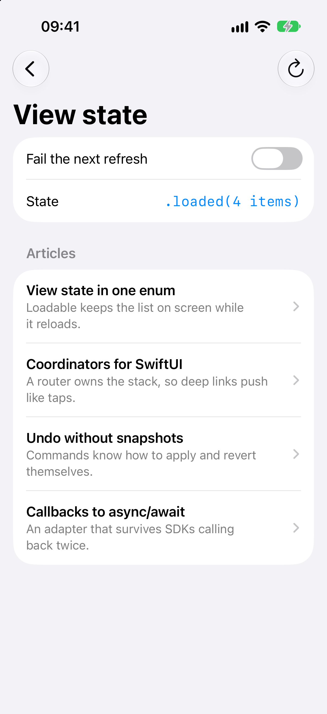
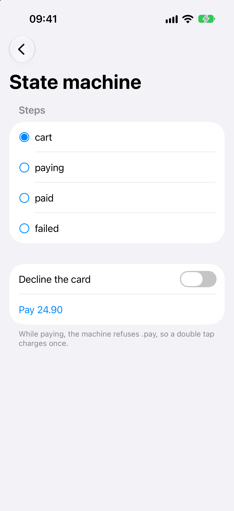
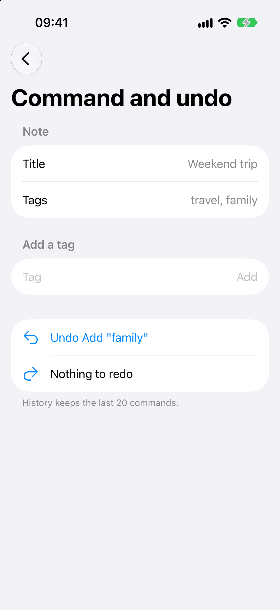
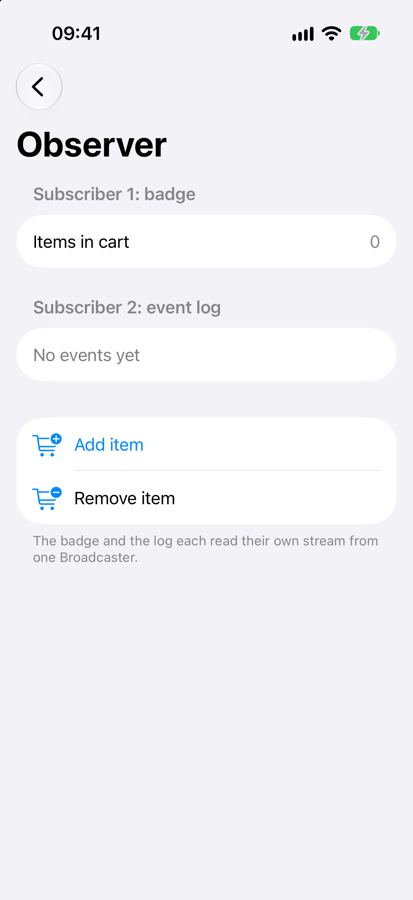
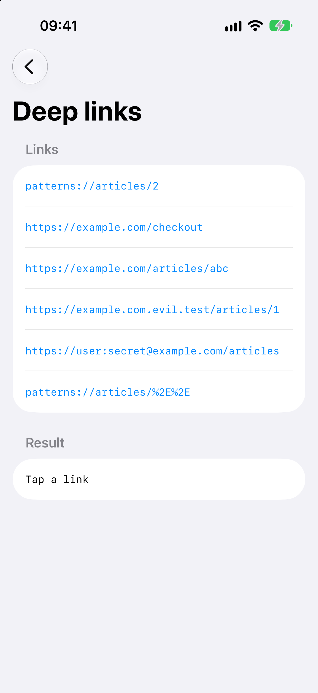
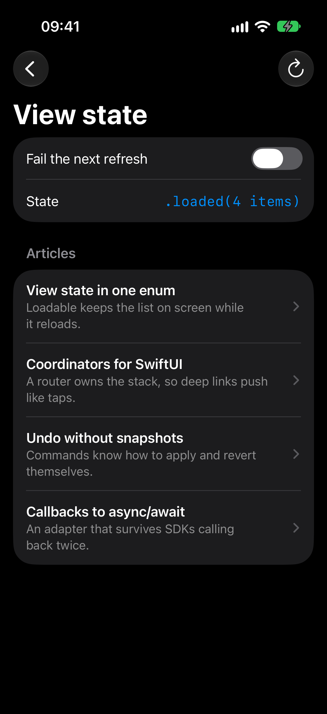
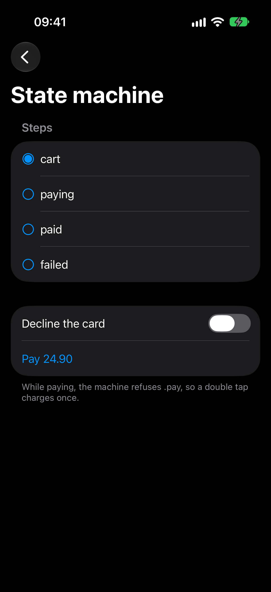
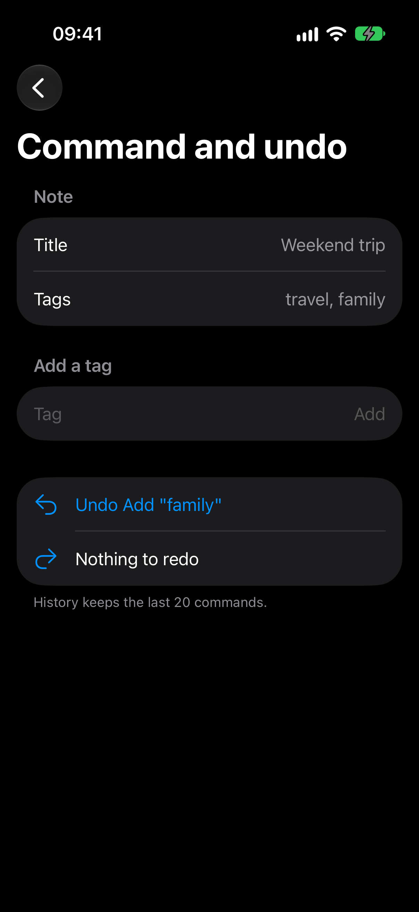
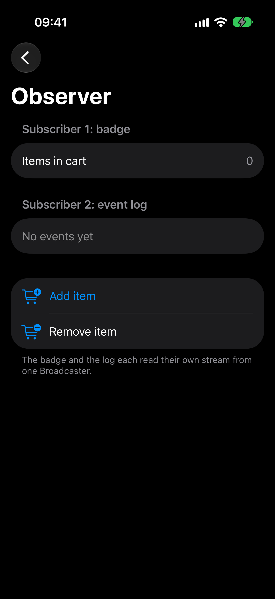
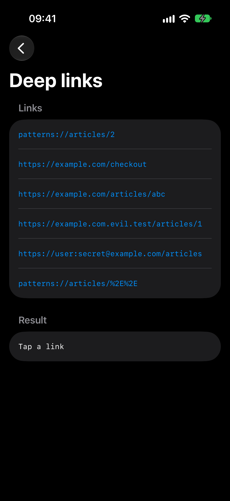

<!-- i18n-source: README.md@16017df9aef14bbde7c1c89e6d452012f4124845 status=reviewed -->
<!-- brand:start -->

<p align="center"><picture><source media="(prefers-color-scheme: dark)" srcset="https://raw.githubusercontent.com/muhittincamdali/mobile-design-patterns/main/.github/brand/banner-dark.svg"><source media="(prefers-color-scheme: light)" srcset="https://raw.githubusercontent.com/muhittincamdali/mobile-design-patterns/main/.github/brand/banner-light.svg"></picture></p>

<!-- lang-selector:start -->
<p align="center"><a href="README.md">English</a> · <a href="README.tr.md">Türkçe</a> · <a href="README.zh-CN.md">简体中文</a> · <a href="README.ja.md">日本語</a> · <a href="README.ko.md">한국어</a> · <a href="README.es.md">Español</a> · <a href="README.de.md">Deutsch</a> · <a href="README.fr.md">Français</a> · <a href="README.pt-BR.md">Português (Brasil)</a> · <a href="README.ru.md">Русский</a></p>
<!-- lang-selector:end -->

<p align="center">
<a href="https://github.com/muhittincamdali/mobile-design-patterns/actions/workflows/ci.yml"></a>
<a href="https://github.com/muhittincamdali/mobile-design-patterns/releases"><picture><source media="(prefers-color-scheme: dark)" srcset="https://raw.githubusercontent.com/muhittincamdali/mobile-design-patterns/main/.github/brand/badge-version-dark.svg"><source media="(prefers-color-scheme: light)" srcset="https://raw.githubusercontent.com/muhittincamdali/mobile-design-patterns/main/.github/brand/badge-version-light.svg"></picture></a>
<a href="https://github.com/muhittincamdali/mobile-design-patterns/blob/main/Package.swift"><picture><source media="(prefers-color-scheme: dark)" srcset="https://raw.githubusercontent.com/muhittincamdali/mobile-design-patterns/main/.github/brand/badge-platforms-dark.svg"><source media="(prefers-color-scheme: light)" srcset="https://raw.githubusercontent.com/muhittincamdali/mobile-design-patterns/main/.github/brand/badge-platforms-light.svg"></picture></a>
<a href="https://github.com/muhittincamdali/mobile-design-patterns/blob/main/Package.swift"><picture><source media="(prefers-color-scheme: dark)" srcset="https://raw.githubusercontent.com/muhittincamdali/mobile-design-patterns/main/.github/brand/badge-language-dark.svg"><source media="(prefers-color-scheme: light)" srcset="https://raw.githubusercontent.com/muhittincamdali/mobile-design-patterns/main/.github/brand/badge-language-light.svg"></picture></a>
<a href="https://github.com/muhittincamdali/mobile-design-patterns/blob/main/LICENSE"><picture><source media="(prefers-color-scheme: dark)" srcset="https://raw.githubusercontent.com/muhittincamdali/mobile-design-patterns/main/.github/brand/badge-license-dark.svg"><source media="(prefers-color-scheme: light)" srcset="https://raw.githubusercontent.com/muhittincamdali/mobile-design-patterns/main/.github/brand/badge-license-light.svg"></picture></a>
</p>

<p align="center">
<a href="#hızlı-başlangıç"><picture><source media="(prefers-color-scheme: dark)" srcset="https://raw.githubusercontent.com/muhittincamdali/mobile-design-patterns/main/.github/brand/button-start-tr-dark.svg"><source media="(prefers-color-scheme: light)" srcset="https://raw.githubusercontent.com/muhittincamdali/mobile-design-patterns/main/.github/brand/button-start-tr-light.svg"></picture></a>
<a href="https://muhittincamdali.github.io/mobile-design-patterns/documentation/mobilepatterns/"><picture><source media="(prefers-color-scheme: dark)" srcset="https://raw.githubusercontent.com/muhittincamdali/mobile-design-patterns/main/.github/brand/button-docs-tr-dark.svg"><source media="(prefers-color-scheme: light)" srcset="https://raw.githubusercontent.com/muhittincamdali/mobile-design-patterns/main/.github/brand/button-docs-tr-light.svg"></picture></a>
<a href="https://github.com/muhittincamdali/mobile-design-patterns/tree/main/Examples"><picture><source media="(prefers-color-scheme: dark)" srcset="https://raw.githubusercontent.com/muhittincamdali/mobile-design-patterns/main/.github/brand/button-examples-tr-dark.svg"><source media="(prefers-color-scheme: light)" srcset="https://raw.githubusercontent.com/muhittincamdali/mobile-design-patterns/main/.github/brand/button-examples-tr-light.svg"></picture></a>
</p>

> Bu belge İngilizce README'nin çevirisidir. İkisi arasında fark varsa güncel olan İngilizce sürümdür.

<!-- brand:end -->

iOS ve macOS uygulamaları için, tek tek kullanabileceğiniz küçük tipler olarak yazılmış tasarım kalıplarından oluşan bir Swift paketi: görünüm durumu, durum makinesi, coordinator ve deep link'ler, repository, decorator'lar, adapter, observer, geri alma destekli command ve builder. Kalıp adlarını bilen ve gerçek bir uygulamada işe yarayan bir sürümünü isteyen uygulama geliştiricilerine yöneliktir: ödeme sürerken ikinci dokunuşu reddeden, iki kez çağrılan bir completion handler'ı sorunsuz atlatan ve yolunda `..` bulunan bir deep link'i geri çeviren bir sürüm. Her kalıbın testleri vardır, README örnekleri test olarak derlenip çalışır ve bir örnek uygulama her birini ekranda gösterir. Görünüm durumu, durum makinesi ve geri alma ayrıca Flutter ve React Native paketleri olarak da sunulur.

## Öne çıkanlar

- **Kalıp başına bir tip** — `Loadable`, `StateMachine`, `Router`, `DeepLinkParser`,
  `Repository`, `AsyncLoader`, `withCompletion`, `Broadcaster`, `UndoStack` ve
  `RequestBuilder`; temel sınıf yok, benimsenecek bir framework yok, bağımlılık yok.
- **Uç durumlar ele alınmış ve test edilmiş** — geride kalan istekler önbelleğe alınmaz, yeniden yükleme listeyi ekranda tutar, iptal edilen iş asla yeniden denenmez, yavaş bir abone belleği büyütemez, satır sonu içeren başlık değerleri reddedilir, sayısal link parametreleri taşma durumunda çökmez.
- **Swift 6 dil modu** — paket, sıkı eşzamanlılık denetimiyle ve uyarısız derlenir; paylaşılan durum actor'larda ya da bir kilidin arkasında tutulur.
- **Test edilmiş** — macOS'ta 96, iPhone simülatöründe 95 Swift Testing testi (exit test'ler yalnızca macOS'ta çalışır); bunlara README örnekleri ve örnek uygulamanın stub'lanmış `URLSession` karşısındaki gerçek istemcisi de dahildir.
- **Örnek uygulama** — iOS ve macOS için [PatternGallery](Examples/PatternGallery); her kalıp için bir ekran vardır, CI her iki platform için de derler.
- **Flutter ve React Native portları** — görünüm durumu, durum makinesi ve geri alma; bir Flutter paketi (11 test) ve React hook'u içeren bir TypeScript paketi (17 test) olarak [`ports/`](ports) klasöründedir.

## Hızlı başlangıç

**1. Paketi ekleyin**

Xcode'da **File › Add Package Dependencies…** menüsünü seçin ve depo adresini girin:

```text
https://github.com/muhittincamdali/mobile-design-patterns.git
```

**2. Modülü içe aktarın**

```swift
import MobilePatterns
```

**3. Kullanın**

Makaleleri bir repository üzerinden yükleyen ve tek bir görünüm durumu sunan bir view model. Yenileme mevcut listeyi ekranda tutar, başarısız bir yenileme de onu korur:

```swift
@MainActor
@Observable
final class ArticleListModel {
    private(set) var state: Loadable<[Article], ArticleError> = .idle

    private let repository: Repository<String, [Article]>

    init(client: ArticleClient) {
        repository = Repository(capacity: 1, timeToLive: .seconds(300)) { _ in try await client.list() }
    }

    /// Shows cached articles when they are fresh, otherwise loads them.
    func load() async {
        await load(policy: .cacheFirst)
    }

    /// Pull to refresh: keeps the list on screen and replaces it when the new one arrives.
    func refresh() async {
        await load(policy: .reloadIgnoringCache)
    }

    private func load(policy: CachePolicy) async {
        state.startLoading()
        do {
            state.finish(with: .success(try await repository.value(for: "articles", policy: policy)))
        } catch {
            state.finish(with: .failure(error as? ArticleError ?? .offline))
        }
    }
}
```

Görünüm listeyi `state.value`, ilerleme göstergesini `state.isLoading` ve hata bandını `state.failure` üzerinden okur.

## Kurulum

### Swift Package Manager

Xcode'da **File › Add Package Dependencies…** menüsünü seçin ve depo adresini girin:

```text
https://github.com/muhittincamdali/mobile-design-patterns.git
```

Ya da `Package.swift` dosyanızdaki `dependencies` listesine ekleyin:

```swift
dependencies: [
    .package(url: "https://github.com/muhittincamdali/mobile-design-patterns.git", from: "2.0.0")
],
targets: [
    .target(name: "YourApp", dependencies: [
        .product(name: "MobilePatterns", package: "mobile-design-patterns")
    ])
]
```

### Flutter ve React Native

Portlar pub.dev veya npm'de yayımlanmaz. `ports/flutter` ya da `ports/react-native` klasörünü projenize kopyalayın veya klasöre yol (path) üzerinden bağımlı olun; ikisi de [ports/README.md](ports/README.md) dosyasında gösterilir.

## Kullanım

Aşağıdaki her örnek, örnek uygulamanın derlediği ve paket testlerinin çalıştırdığı [`ReadmeSamples.swift`](Examples/PatternGallery/PatternGallery/ReadmeSamples.swift) dosyasından alınmıştır.

### Durum makinesiyle ikinci dokunuşu reddedin

Geçişler tek bir `switch` ifadesidir. Makine `.paying` durumundayken `.pay` olayına izin verilmez, bu yüzden çift dokunuşta tahsilat bir kez yapılır:

```swift
@MainActor
@Observable
final class CheckoutModel {
    private(set) var machine = StateMachine<CheckoutStep, CheckoutEvent>(initial: .cart) { step, event in
        switch (step, event) {
        case (.cart, .pay), (.failed, .retry): .paying
        case (.paying, .succeed): .paid
        case (.paying, .fail): .failed
        default: nil
        }
    }

    private let charge: @Sendable () async throws -> Void

    init(charge: @escaping @Sendable () async throws -> Void) {
        self.charge = charge
    }

    var step: CheckoutStep { machine.state }
    var canPay: Bool { machine.canSend(.pay) || machine.canSend(.retry) }

    /// Charges once. A second tap while paying is refused by the state machine.
    func pay() async {
        guard machine.send(.pay) != nil || machine.send(.retry) != nil else { return }
        do {
            try await charge()
            machine.send(.succeed)
        } catch {
            machine.send(.fail)
        }
    }
}
```

### Deep link'leri bir router üzerinden açın

`DeepLinkParser`, bir kalıpla eşleştirmeden önce scheme'i, host'u, kimlik bilgilerini, `.` ve `..` segmentlerini, kodlamayı, kontrol karakterlerini ve boyutları denetler. Bir kalıp yığının tamamını döndürür, böylece geri düğmesi çalışır:

```swift
extension DeepLinkParser where Route == AppRoute {
    /// Accepts `https://example.com/…` universal links and `patterns://…` URLs.
    static let app = DeepLinkParser(
        schemes: ["https", "patterns"],
        hosts: ["example.com"],
        patterns: [
            .init("articles") { _ in [.articles] },
            .init("articles/:id") { parameters in
                parameters.int("id").map { [.articles, .article(id: $0)] }
            },
            .init("checkout") { _ in [.checkout] },
            .init("notes") { _ in [.editor] },
            .init("links") { _ in [.links] },
            .init("cart") { _ in [.cart] }
        ]
    )
}

extension Router where Route == AppRoute {
    /// Opens a deep link. Returns `false` and keeps the stack when the link is refused.
    @discardableResult
    func open(_ url: URL) -> Bool {
        guard let routes = try? DeepLinkParser.app.routes(for: url) else { return false }
        return replaceStack(with: routes)
    }
}
```

Uygulamada yığını `NavigationStack(path: $router.path)` gösterir, yığını da `.onOpenURL { router.open($0) }` besler.

### Decorator'larla yeniden deneme, zaman sınırı ve istek paylaşımı ekleyin

`RequestBuilder` yolu ve sorguyu kodlar, güvensiz başlıkları reddeder; `AsyncLoader` davranışı katmanlar halinde, dıştan içe doğru ekler:

```swift
let api = RequestBuilder(baseURL: baseURL).header("Accept", "application/json").timeout(.seconds(15))

// Decorators: a time limit per attempt, two retries for server errors, one shared
// request when several screens ask for the same article.
let article = AsyncLoader<Int, Article> { id in
    try await get(api.path("articles", String(id)), session: session)
}
    .timeout(.seconds(10))
    .retrying(maxAttempts: 3, delay: .milliseconds(300)) { error in
        if case ArticleError.badResponse(let status) = error { return status >= 500 }
        return error is AsyncLoaderTimeoutError
    }
    .coalescing()
```

### Komutlarla düzenlemeleri geri alın

```swift
extension EditCommand where Document == Note {
    static func rename(to title: String, from old: String) -> Self {
        .set("Rename", \.title, to: title, from: old)
    }

    static func addTag(_ tag: String) -> Self {
        EditCommand("Add \"\(tag)\"") { $0.tags.append(tag) } revert: { $0.tags.removeLast() }
    }
}

/// Two edits and one undo: the title stays, the tag is gone, and "Rename" is next to undo.
func editedNote() -> UndoStack<Note> {
    var editor = UndoStack(Note(), limit: 20)
    editor.perform(.rename(to: "Weekend trip", from: editor.document.title))
    editor.perform(.addTag("travel"))
    editor.undo()
    return editor
}
```

### Callback tabanlı bir SDK'yı sarmalayın

`withCompletion` ilk sonucu tutar, sonraki callback'leri yok sayar ve görev iptal edilir edilmez `CancellationError` döndürür:

```swift
extension LegacyLocator {
    func currentCity() async throws -> String {
        try await withCompletion { completion in
            locate { city, error in
                if let city { completion(.success(city)) } else { completion(.failure(error ?? ArticleError.offline)) }
            }
        }
    }
}
```

### Olayları birden çok dinleyiciye gönderin

`Broadcaster.events()` ile alınan her akış, kendi sınırlı tamponuyla sonraki her olayı alır:

```swift
@MainActor
@Observable
final class CartBadge {
    private(set) var count = 0

    func listen(to events: AsyncStream<CartEvent>) async {
        for await event in events {
            switch event {
            case .added: count += 1
            case .removed: count = max(0, count - 1)
            }
        }
    }
}
```

Her dinleyiciye kendi akışını verin (`badge.listen(to: cartEvents.events())`), ardından sepet her değiştiğinde `cartEvents.send(.added(itemID: 7))` çağırın.

## Demo

Örnek uygulamanın bir iPhone simülatöründeki ekranları; [`scripts/capture-screens.sh`](scripts/capture-screens.sh) ile alınmıştır:

| Görünüm durumu | Durum makinesi | Command ve geri alma | Observer | Deep link'ler |
| --- | --- | --- | --- | --- |
|  |  |  |  |  |
|  |  |  |  |  |

Kalıpları kendiniz denemek için `PatternGallery.xcodeproj` dosyasını [`Examples/PatternGallery`](Examples/PatternGallery) klasöründen Xcode ile açın, bir iPhone simülatörü ya da **My Mac** seçin ve **Run**'a basın. Çalışan uygulamada bir deep link'in nasıl açılacağı da [Examples/README.md](Examples/README.md) dosyasında gösterilir.

## Dokümantasyon

API başvuru belgeleri ve makaleler:

- [API başvurusu](https://muhittincamdali.github.io/mobile-design-patterns/documentation/mobilepatterns/)
  (DocC, `main` dalından GitHub Pages'e yayımlanır)
- Xcode'da **Product › Build Documentation** ile ya da komut satırından yerelde derleyin:

```sh
xcodebuild docbuild -scheme MobilePatterns -destination 'generic/platform=macOS'
```

## Rehberler

- [Getting Started](https://muhittincamdali.github.io/mobile-design-patterns/documentation/mobilepatterns/gettingstarted)
  — paketi ekleyin, yükleme bayraklarını tek bir değerle değiştirin, gezintiyi bir router'dan yönetin
  ([kaynak](Sources/MobilePatterns/MobilePatterns.docc/GettingStarted.md)).
- [Choosing a Pattern](https://muhittincamdali.github.io/mobile-design-patterns/documentation/mobilepatterns/choosingapattern)
  — koddaki bir belirtiden onu çözen tipe giden yol ve ne zaman eklememek gerektiği
  ([kaynak](Sources/MobilePatterns/MobilePatterns.docc/ChoosingAPattern.md)).
- [Loading Data with View State](https://muhittincamdali.github.io/mobile-design-patterns/documentation/mobilepatterns/loadingdatawithviewstate)
  — çağrı başına önbellek politikaları, her durumun çizilmesi, önce önbellekten sonra güncel veriyle güncellemeler
  ([kaynak](Sources/MobilePatterns/MobilePatterns.docc/LoadingDataWithViewState.md)).
- [Opening Deep Links Safely](https://muhittincamdali.github.io/mobile-design-patterns/documentation/mobilepatterns/openingdeeplinkssafely)
  — ayrıştırıcının denetimleri sırayla, tek ekran yerine yığınlar, girdiyi geri yansıtmayan hatalar
  ([kaynak](Sources/MobilePatterns/MobilePatterns.docc/OpeningDeepLinksSafely.md)).
- [Flutter ve React Native portları](ports/README.md) — hangi kalıpların taşındığı ve testlerinin nasıl çalıştırılacağı.

## Gereksinimler

| Platform | En düşük sürüm |
| --- | --- |
| iOS | 17 |
| macOS | 14 |
| Araç zinciri | Swift 6.2 · Xcode 26+ |
| Flutter portu | Flutter 3.41 · Dart 3.11 |
| React Native portu | React 19 · testler için Node 22.22 |

## Mimari

```text
Sources/MobilePatterns/
├── State/         Loadable, StateMachine
├── Navigation/    Router, DeepLinkParser
├── Data/          Repository, CachePolicy, AsyncLoader
├── Concurrency/   withCompletion, Broadcaster
├── Editing/       UndoStack, EditCommand
└── Networking/    RequestBuilder
Examples/PatternGallery/   iOS and macOS app; ReadmeSamples.swift is shared with the tests
ports/flutter/             Loadable, LoadableController, LoadableView, StateMachine, UndoStack
ports/react-native/        Loadable, useLoadable, StateMachine, UndoStack
```

Tasarım kararları:

- **Durumun yerel olduğu yerde değer tipleri** (`Loadable`, `StateMachine`, `UndoStack`, `RequestBuilder`), çağıranların durumu paylaştığı yerde bir **actor** (`Repository`) ve herhangi bir thread'den senkron API gereken yerde bir kilit (`Broadcaster`, `withCompletion`).
- **Varsayılan olarak sınırlı.** Router derinliği, repository kapasitesi, geri alma geçmişi, broadcaster tamponları ve deep link boyutlarının hepsinin sınırı vardır; alt sınırın altındaki değerler çökmek yerine alt sınıra yükseltilir.
- **Dışarıdan gelen girdi kullanılmadan önce denetlenir.** Deep link'ler ve istek parçaları doğrulanır, hatalar reddedilen girdinin bir kopyasını taşımaz.
- **README eskimez.** Örnekleri, örnek uygulamanın derlediği ve testlerin çalıştırdığı bir Swift dosyasında durur.

## Yol haritası

- Paket, 2.0.0 sürümünden sonra Swift Package Index'e eklenecek; `.spi.yml` depoda zaten var.
- `DeepLinkParser` Dart ve TypeScript'e taşınacak; aynı denetimler `go_router` ve React Navigation link'leri için de geçerlidir.
- Arama alanları için, test saatiyle birlikte bir debouncer eklenecek.

## Katkıda bulunma

Katkılarınızı bekliyoruz. Pull request açmadan önce [katkı rehberini](https://github.com/muhittincamdali/mobile-design-patterns/blob/main/CONTRIBUTING.md) ve [davranış kurallarını](https://github.com/muhittincamdali/mobile-design-patterns/blob/main/CODE_OF_CONDUCT.md) okuyun. Güvenlik açıklarını [güvenlik politikasında](https://github.com/muhittincamdali/mobile-design-patterns/blob/main/SECURITY.md) anlatıldığı gibi gizli olarak bildirin.

## Lisans

MIT lisansıyla yayımlanmıştır. Ayrıntılar için [LICENSE](LICENSE) dosyasına bakın.
